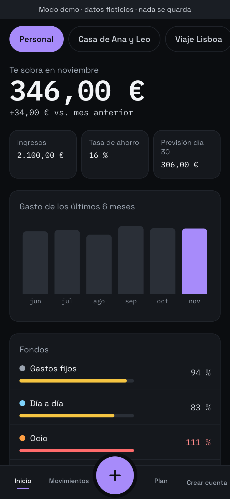
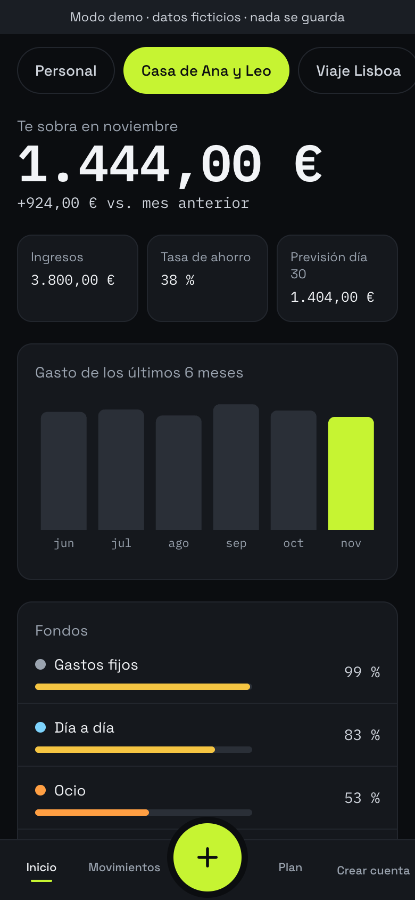
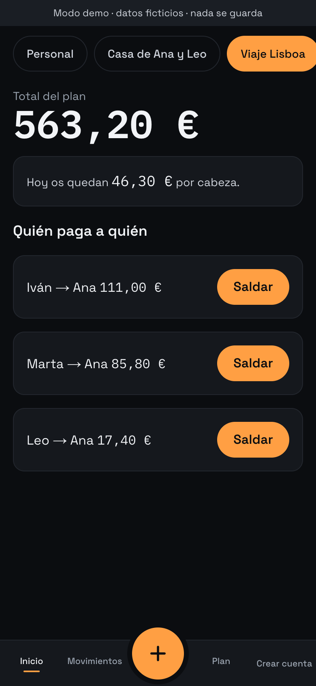
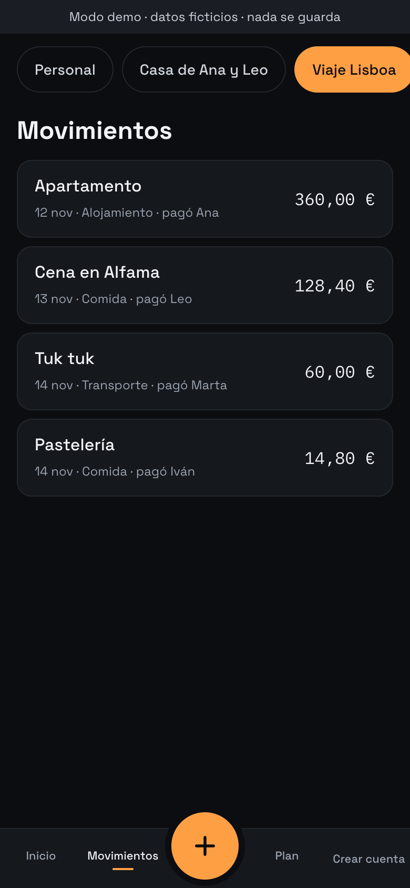
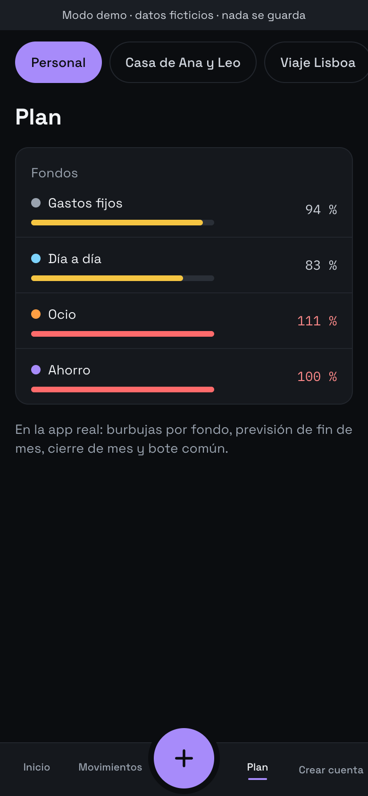
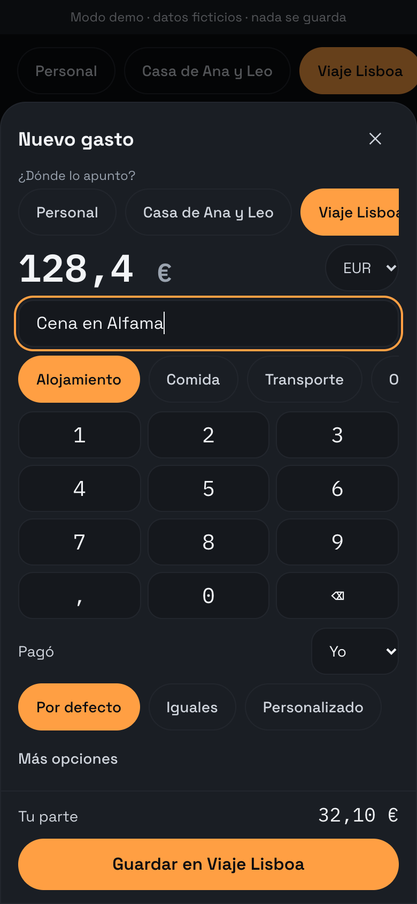

# Fifti

*Cuentas claras en casa, en pareja y de fiesta.*

PWA de finanzas personales, de pareja y de grupo. El dinero se organiza en **burbujas**:

- **Personal**: privada. Ingresos, gastos, plan del mes y metas.
- **Hogar** (fija): pareja o piso, con bote común proporcional a los ingresos, gastos fijos y ahorro.
- **Plan espontáneo**: una cena o un viaje. Se comparte por enlace o QR, entran sin cuenta y al cerrarlo sale quién paga a quién.

**Qué la diferencia de Tricount:** todo está conectado. Tu parte de cada gasto de grupo entra sola en tu plan personal, así sabes lo que gastas de verdad en el mes (casa + pareja + salidas). Además tiene plan mensual por fondos, previsión de fin de mes, cierre de mes, bote común y metas de ahorro.

Prueba la demo (datos ficticios, sin registro) en `/demo`.

## Capturas

Capturas reales de la demo (`/demo`, datos ficticios: Ana, Leo, «Viaje Lisboa»).

| Inicio (personal) | Inicio (hogar) | Quién paga a quién |
|---|---|---|
|  |  |  |

| Movimientos | Plan por fondos | Nuevo gasto en grupo |
|---|---|---|
|  |  |  |

## Stack

Next.js 16 (App Router) · TypeScript estricto · Tailwind CSS 4 · Supabase (Postgres, Auth, Storage, RLS, pg_cron) · Zod · Recharts + d3-hierarchy · next-intl · tesseract.js · Vitest · Vercel

## Decisiones técnicas

- **Dinero en céntimos** (enteros; `bigint` en Postgres) y **porcentajes en puntos básicos** (10000 = 100 %). Los repartos usan el método del mayor resto: la suma siempre cuadra al céntimo. Toda la lógica de dinero son funciones puras en `src/lib/money`, con tests de propiedades.
- **RLS en todas las tablas** (38) con `FORCE ROW LEVEL SECURITY`, privilegios por columna y funciones `security definer` con `search_path` fijo. Las escrituras sensibles (gastos, liquidaciones, invitaciones, compensaciones) van por RPC atómicas que validan pertenencia, sumas e importes.
- **Sesión en cookies `httpOnly`** (`@supabase/ssr`); no hay cliente de Supabase en el navegador y la `service_role` solo existe en el servidor (`server-only`).
- **Invitados sin cuenta** = sesiones anónimas de Supabase Auth, ligadas por RLS a un solo grupo y un solo perfil; pueden convertirse en cuenta conservando su historial.
- **Enlaces** (invitación, invitado, reclamar perfil, resumen público): token de 32 bytes, solo se guarda su hash, con caducidad, usos máximos y revocación.
- **Sincronización offline**: cola en IndexedDB con `client_id` idempotente; reenviar nunca duplica. Service worker propio con lectura offline y sin cachear páginas con tokens.
- **Gastos privados** dentro de un grupo: el detalle vive en una tabla aparte legible solo por su autor; los demás ven «Gasto privado» con importe y reparto.
- **Historial** inmutable (solo inserción) escrito por triggers.
- **Tickets**: tipo real por magic bytes, máx. 5 MB, recodificado a WebP sin EXIF, bucket privado y URL firmada de 5 minutos. OCR en el navegador con archivos servidos desde el propio dominio.
- **Contraseñas** comprobadas contra Have I Been Pwned por k-anonymity (solo salen 5 caracteres del hash SHA-1).
- **CSV**: escape de inyección de fórmulas al exportar; al importar, límites de tamaño y filas, validación por fila y vista previa.

## Cómo ejecutarlo

Requisitos: Node 24+ y Docker (Supabase local y tests de RLS).

```bash
npm install
cp .env.example <tu archivo local de entorno>   # y rellena las claves
npx supabase start                              # base de datos local con las migraciones
npm run dev
```

Variables: URL y clave anónima de Supabase, `SUPABASE_SERVICE_ROLE_KEY`, `RATE_LIMIT_SALT`, `CRON_SECRET`, y las claves VAPID (`npx web-push generate-vapid-keys`) para las notificaciones.

Scripts: `npm test` (lógica de dinero, validación, CSV, cola offline…), `npm run test:rls` (políticas contra Supabase), `npm run lint`, `npm run typecheck`, `npm run check` (todo + build), `npm run icons` (logo e iconos).

## Pruebas

- `npm test`: lógica de dinero, validación, CSV, cola offline y service worker.
- `npm run test:rls`: políticas de RLS contra Supabase local.
- `npm run e2e:sheet`: comprueba en el navegador (375×812) que «Guardar» y «Tu parte» quedan dentro de la pantalla en la demo y en la app.
- `scripts/e2e/walkthrough.mjs`: recorrido completo con una cuenta ficticia y un invitado.

## Licencia

MIT. Ver [LICENSE](LICENSE).

## Seguridad

CI con `gitleaks`, `osv-scanner`, `npm audit` y Dependabot. En el repo solo hay archivos de ejemplo de variables; ningún secreto ni dato real.
