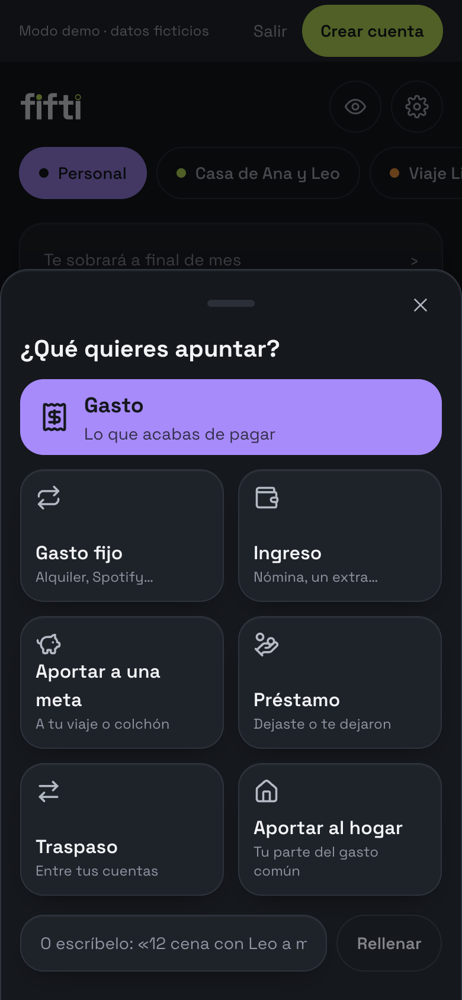
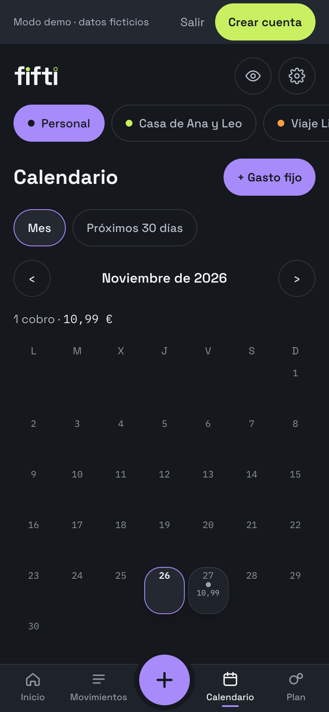
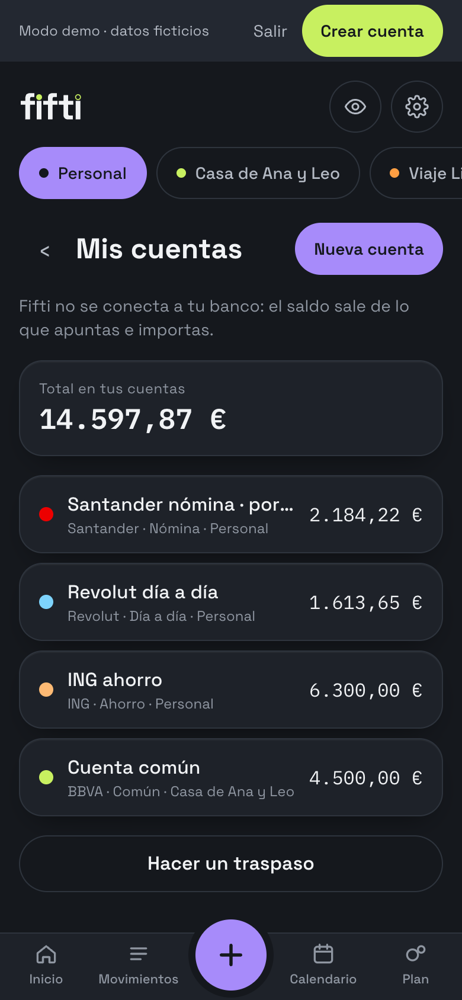
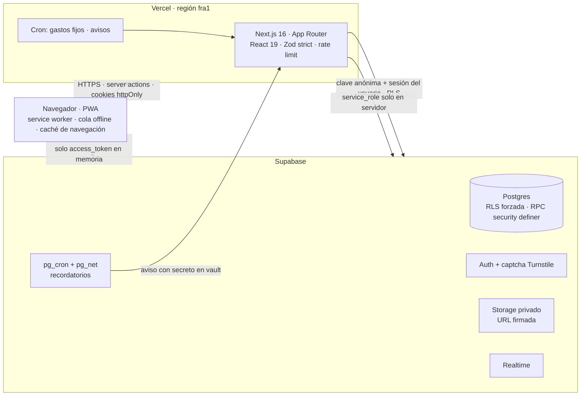

# Fifti

*Cuentas claras en casa, en pareja y de fiesta.*

**App:** https://fifti-seven.vercel.app · **Demo sin registro (datos ficticios):** https://fifti-seven.vercel.app/demo

> **In English.** Fifti is an installable web app (PWA) for personal, couple and group finances. Your money is organised in **spaces**: a private *Personal* space, a shared *Home* (couple or flatmates, with a common pot split in proportion to income) and *Groups* in the style of Tricount, where guests join by link or QR without an account. Everything is connected: your share of every shared expense flows into your personal budget. It also has a monthly budget split by percentage, fixed expenses with a calendar and reminders, bank accounts with balances and transfers ("Split your pay"), savings goals, loans, a live shopping list, bank statement import (Santander, BBVA, CaixaBank, ING, Revolut, N26), category rules, quick-phrase entry, a PDF monthly report, discreet mode, app lock, Spanish/English and dark/light themes. Money is stored as integer cents, every table has forced Row Level Security, and the whole UI is available in both languages. The rest of this document is in Spanish.

## Qué es Fifti y para quién

Fifti es una PWA de finanzas para **una persona**, **una pareja** o **un grupo** (un viaje, una cena, un piso). Está pensada para quien quiere saber, sin hojas de cálculo, cuánto le sobrará a final de mes y quién debe a quién.

Qué la diferencia de Tricount: **todo está conectado**. Tu parte de cada gasto compartido entra sola en tu presupuesto personal, así ves lo que gastas de verdad (casa + pareja + salidas). Además trae presupuesto mensual por partidas, previsión de fin de mes, cuentas bancarias con saldos y metas de ahorro.

Fifti **no se conecta a ningún banco ni mueve dinero**: los saldos salen de lo que apuntas y de los extractos que importas. No guarda IBAN, números de cuenta ni credenciales; una cuenta es solo un nombre, un banco (texto), un color, un tipo y un saldo inicial.

## Capturas

Capturas reales de la demo (datos ficticios: Ana, Leo, «Viaje Lisboa»), a 390 px y en oscuro.

| Inicio | El botón + | Calendario |
|---|---|---|
|  |  |  |

| Plan | Cuentas | Ajustes |
|---|---|---|
|  |  |  |

## Funciones

**Espacios**
- **Personal**: privado. Ingresos, gastos, presupuesto y metas.
- **Hogar**: pareja o piso, con bote común proporcional a los ingresos, gastos fijos, ahorro y balance de quién debe a quién. Invitación a la pareja en un paso.
- **Grupos** (una cena, un viaje): se comparten por enlace o QR, los **invitados entran sin cuenta** y al cerrar el plan sale quién paga a quién (con cambio de moneda, gastos privados y pagador rotativo).

**Dinero**
- **Presupuesto y partidas por %**: Fijos, Día a día, Ocio y Ahorro (y las que añadas), con barra, ritmo diario, aviso al 80 % y cierre de mes. Previsión «Te sobrará a final de mes» única en Inicio y Plan.
- **Gastos fijos** mensuales, semanales, trimestrales y anuales, con **calendario**, «saltar este mes» y aviso previo (1, 3 o 7 días) sin importes en la notificación.
- **Cuentas bancarias** con saldo (inicial + ingresos − gastos ± traspasos), detalle por cuenta y «Ajustar saldo» que deja un ajuste visible.
- **Traspasos** entre cuentas: no cuentan como gasto ni ingreso. **Reparte tu nómina**: con las cuentas asociadas a cada partida, Fifti te dice cuánto pasar a cada una y se marca con un toque.
- **Aportar al hogar**: sale de tu plan personal y entra en el hogar a tu nombre; un traspaso a la cuenta común cuenta como aportación, una sola vez.
- **Metas de ahorro** con ritmo, hitos y retos; **préstamos** sueltos con recordatorio; **lista de la compra** compartida en directo.
- **Vaciar un espacio** (solo su creador, con confirmación escribiendo el nombre y 10 s para deshacer).

**Entrada rápida**
- Botón **+** con gasto, gasto fijo, ingreso, meta, préstamo, traspaso y aportación; **frase rápida** («12 cena con Leo a medias»), **atajo de Siri**, favoritos con pulsación larga y escaneo de tickets con OCR en el navegador.
- **Importar extractos** de Santander, BBVA, CaixaBank, ING, Revolut y N26 (o mapear columnas), por cuenta, con duplicados detectados contra lo apuntado a mano y ajuste de saldo si el CSV lo trae.
- **Reglas de categoría** con aprendizaje.

**Análisis y ajustes**
- Tendencias por partida, **informe mensual en PDF**, «Tu año en Fifti».
- **Modo discreto**, **bloqueo** de la app, notificaciones push opcionales, **español e inglés**, tema **oscuro y claro**, funciona sin conexión.

## Arquitectura



**Decisiones técnicas**
- **Dinero en céntimos** (enteros; `bigint` en Postgres) y **porcentajes en puntos básicos** (10000 = 100 %). Los repartos usan el **método del mayor resto**: la suma siempre cuadra al céntimo. Toda la lógica de dinero son funciones puras en `src/lib/money`, con tests de propiedades.
- **Los meses son el primer día** (`2026-11-01`) y una sola función de previsión (`monthOutlook`) alimenta Inicio y Plan.
- **RLS en todas las tablas** (48) con `FORCE ROW LEVEL SECURITY`, privilegios por columna y funciones `security definer` con `search_path` fijo. Las escrituras sensibles (gastos, liquidaciones, invitaciones, cuentas, traspasos, vaciar espacio) van por RPC atómicas que validan pertenencia, sumas e importes.
- **Sesión en cookies `httpOnly`** (`@supabase/ssr`); no hay cliente de Supabase en el navegador salvo el canal Realtime, que recibe solo el `access_token`, en memoria (excepción E1 en SECURITY.md).
- **Demo con proveedor en memoria**: `/demo` monta **las mismas páginas** que la app real, pero el cliente de datos es un proveedor en memoria de solo lectura (escribir responde «Crea una cuenta para guardar»). Un test de paridad comprueba que demo y cuenta real exponen los mismos elementos.
- **Rendimiento con el servidor lejos**: funciones en `fra1`, consultas de cada página en una sola tanda, esqueletos de carga, precarga de las pestañas, **caché de navegación en el cliente** (se muestra al instante y se revalida por detrás) y respuesta optimista al guardar.
- **Sincronización offline**: cola en IndexedDB con `client_id` idempotente; reenviar nunca duplica. **Service worker** propio versionado por despliegue, con red primero para HTML y solo recursos con hash en caché; no cachea páginas con tokens.
- **Invitados sin cuenta** = sesiones anónimas de Supabase Auth ligadas por RLS a un solo grupo y un solo perfil; pueden convertirse en cuenta conservando su historial.
- **Enlaces** (invitación, invitado, reclamar perfil, resumen público): token de 32 bytes, solo se guarda su hash, con caducidad, usos máximos y revocación.
- **Gastos privados** dentro de un grupo: el detalle vive en una tabla aparte legible solo por su autor. **Historial** inmutable (solo inserción) escrito por triggers.
- **Tickets**: tipo real por magic bytes, máx. 5 MB, recodificado sin EXIF, bucket privado y URL firmada de 5 minutos; OCR en el navegador con archivos propios.
- **CSV**: escape de inyección de fórmulas al exportar; al importar, límites, validación por fila y vista previa.

## Seguridad

Resumen de la checklist de 20 puntos (el detalle, con cómo se comprueba cada uno, está en **[SECURITY.md](SECURITY.md)**):

- **RLS forzada** en las 48 tablas y permisos validados en el servidor, nunca solo en la interfaz; protección contra IDOR con UUID + RLS + tests.
- **Zod `.strict()`** en cada acción del servidor (nada de asignación masiva) y SQL siempre parametrizado.
- **Rate limiting** por IP y usuario (acceso, registro, recuperación, invitaciones, invitados, importación, planes y cuentas) que falla cerrado.
- **CSP estricta** y cabeceras de seguridad (HSTS, `X-Frame-Options`, `nosniff`…); sin `dangerouslySetInnerHTML`; sin stack traces al usuario; sin CORS abierto.
- **Contraseñas** en Supabase Auth, comprobadas contra *Have I Been Pwned* por k-anonymity; email confirmado antes de usar la cuenta.
- **Cloudflare Turnstile** en registro, acceso, recuperación e invitados: el token llega a Supabase Auth, que lo valida.
- **Sin secretos en git** (gitleaks en CI) y dependencias vigiladas (Dependabot, `npm audit`, osv-scanner).
- **Sin datos bancarios sensibles**: nada de IBAN, números de cuenta ni credenciales; Fifti no se conecta a bancos.

## Calidad

| Qué | Cifra actual |
|---|---|
| Tests unitarios (dinero, previsión, calendario, CSV, parser de frases, contraste AA…) | **296** |
| Tests de RLS contra Supabase real (incluye cuentas, traspasos, vaciar espacio) | **122** |
| Pruebas de punta a punta con Playwright, con sesión real, en móvil (390×844) y escritorio | **36** en verde (+4 opcionales) |
| Desbordes horizontales a 390 px, en oscuro y claro, en todas las pantallas | **0** |
| Paridad demo / cuenta real (mismos elementos tocables) y barrido de textos rotos en es y en | **verde** |
| Lighthouse (Inicio, producción, móvil) | **93** de rendimiento (LCP 2,7 s) |
| Navegación con 300 ms de latencia simulada: abrir un detalle desde Inicio | **27 ms** (antes 338 ms) |

El **CI** (GitHub Actions) ejecuta lint, tipos, tests, auditoría de dependencias, gitleaks, osv-scanner, RLS y los e2e de Playwright sobre un Supabase local con el captcha de Auth activado (claves de prueba de Cloudflare); las trazas y capturas solo se suben si algo falla.

Comandos: `npm test`, `npm run test:rls`, `npx playwright test`, `npm run e2e:overflow`, `npm run e2e:parity`, `node scripts/e2e/demo-sweep.mjs`, `node scripts/e2e/nav-latency.mjs`.

## Cómo ejecutarlo en local

Requisitos: Node 24+ y Docker (Supabase local y tests de RLS).

```bash
npm install
cp .env.example .env.local                      # y rellena las claves (este archivo no se sube)
npx supabase start                              # base de datos local con las migraciones
npm run dev
```

Variables: URL y clave anónima de Supabase, `SUPABASE_SERVICE_ROLE_KEY`, `RATE_LIMIT_SALT`, `CRON_SECRET`, las claves VAPID para las notificaciones (`npx web-push generate-vapid-keys`) y, para el captcha, `NEXT_PUBLIC_TURNSTILE_SITE_KEY` y `TURNSTILE_SECRET_KEY` (con las claves de prueba de Cloudflare funciona en local y en CI).

Scripts: `npm run check` (tipos + lint + tests + build), `npm run test:rls`, `npm run icons` (logo e iconos). Los e2e necesitan la app compilada y un archivo local con las claves de pruebas (plantilla en `.env.test.example`).

Migraciones en la nube: `supabase db push` después de que pasen en local.

## Pendiente / ideas

- **Monitorización de errores (Sentry)**: opcional y sin instalar. Los pasos y las condiciones de privacidad (sin datos personales, sin replay, CSP solo al host de ingestión) están en [SECURITY.md](SECURITY.md).
- Activar el captcha en el panel de Supabase con la clave secreta de Turnstile (pasos en SECURITY.md).
- La respuesta optimista confirma al instante pero no inserta aún en las listas antes de la respuesta del servidor.
- Ideas: exportar el informe a más formatos, más bancos en la importación, avisos de día de cobro programados por servidor.

## Cambios

Historial por fechas en [CHANGELOG.md](CHANGELOG.md).

## Licencia

MIT. Ver [LICENSE](LICENSE).
